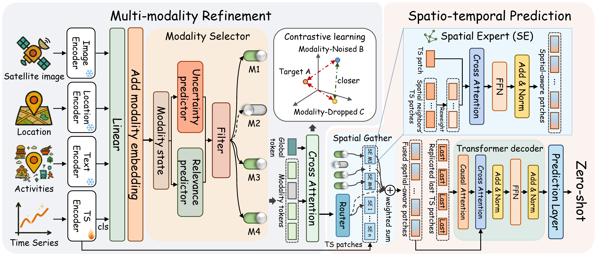

# MoST

This repository contains the official implementation of our KDD 2026 paper, "MoST: A Foundation Model for Multi-modal Spatio-temporal Traffic Prediction." The MoST model is designed to perform traffic prediction in previously unseen cities using any available extra input modalities.




## Getting Started

### Requirements
Experiments were conducted using Python 3.8 and PyTorch 2.4.1 with CUDA 12.4. To install the necessary dependencies, run the following command:

```
pip install -r requirements.txt
```

### Datasets
Traffic data were sourced from [Urban-Dataset](https://github.com/uctb/Urban-Dataset/tree/main) and [LargrST](https://www.kaggle.com/datasets/liuxu77/largest). Point-of-interest (POI) data were obtained from the [Foursquare](https://huggingface.co/datasets/foursquare/fsq-os-places). Satellite imagery was acquired from Google Earth.

To prepare Chicago taxi data from `data/taxi_chi/Taxi_Chicago.zip`, run:

```bash
python prepare_chi.py --root datasets
```

This uses 2013–2015 at the original 15-minute interval and a chronological
70%/10%/20% train/validation/test split. It writes `Taxi_Chicago` data, locations,
distance-based adjacency, training mean/std, and zero POI/satellite placeholders.
Use dataset name `Taxi_Chicago` and modality state `[0,0,1,1]` in your configuration
to disable the unavailable POI and satellite features.

### Running

To train the MoST model, execute the following command. The example configuration file is data_configs/most.yaml. For inference, set the --is_trainingflag to 0.
```
python run.py --is_training 1 --gpu 0
```


## Citation
If you find this work useful for your research, we kindly request citing the following paper:
```
@inproceedings{xu2026most,
  title={MoST: A Foundation Model for Multi-modality Spatio-temporal Traffic Prediction},
  author={Xu, Ronghui and Chen, Jihao and Tian, Jingdong and Guo, Chenjuan and Yang, Bin},
  booktitle={SIGKDD}
  year={2026}
}
```
